<!-- Generated from README.md.tpl by scripts/ApplyTheme.java. Edit the template, not this file. -->

  

  

  
  
  
  

  

  

  

  

 **RydeFlexi / RydeRentACar**: car rental platform built on microservices with integrated payments 
 **Vestra**: product work at RydeRentACar 
 **Orysone**: client projects and the [orysone.com](https://orysone.com) platform 
 **AI tooling**: self-hosted multi-agent setups and MCP servers

  

  

  

  
  
  
  
  
  
  

  

