  

  

  
  
  
  

I'm a **Software Engineer** who builds backend systems with **Java and Spring**, ships them in **Docker**, and runs them on **Kubernetes**. I care about clean APIs, decoupled services and infrastructure that is easy to reason about.

 **Software Engineer at RydeRentACar** (since June 2025), working on **RydeRentACar**, **RydeFlexi** and **Vestra** 
 **Founder of [Orysone](https://orysone.com)**, where I design and build web, backend and AI products for clients 
 Studying for a **BSc (Hons) Top-Up**, Birmingham City University, through Java Institute for Advanced Technology 
 **Certified Kubernetes Administrator (CKA)** 
 Exploring AI agents, MCP servers and LLM integrations

  

   
  

  

  

 **RydeFlexi / RydeRentACar**: car rental platform built on microservices with integrated payments 
 **Vestra**: product work at RydeRentACar 
 **Orysone**: client projects and the [orysone.com](https://orysone.com) platform 
 **AI tooling**: self-hosted multi-agent setups and MCP servers

  

  

  

  
  
  
  
  
  
  

  

